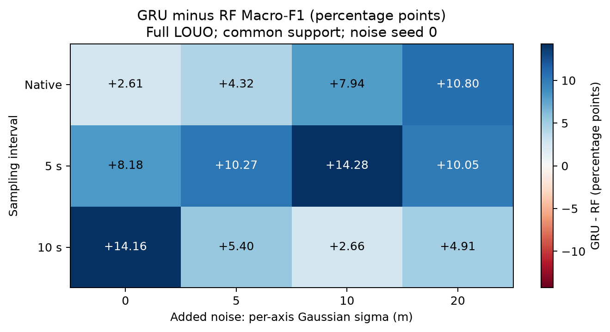
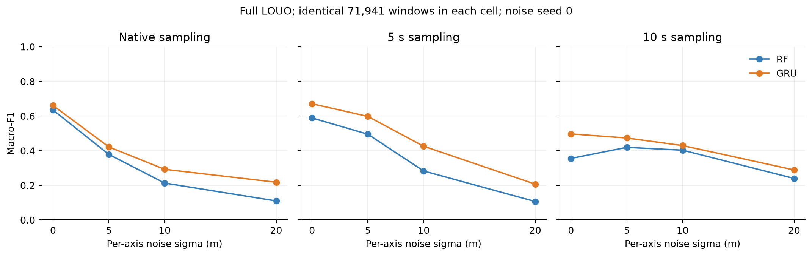

# 组合退化最终结果报告

**本次公共集上 GRU 的 12 个主格点估计值均高于 RF，但领先幅度不随退化程度单调扩大。** 最大差值出现在 5s＋10m，为 14.28 个百分点；10s＋10m 的三种子平均差值仅为 2.59 个百分点，与干净基线的 2.61 点接近。组合退化还出现了抽稀后分数回升的情况，应如实报告，机理归因由 B 的特征分析进一步检验。

## 1 实验范围与验收

| 项目 | 完成范围 |
|---|---|
| 冻结协议 | `degradation_config.yaml` v1.0.0；120s、至少10点、最大断档30s |
| 主网格 | 原生采样/5s/10s × 新增每轴高斯 σ=0/5/10/20m |
| 模型 | 每折在其余用户干净数据上训练 RF balanced300 和 GRU hidden64、序列128、15 epoch；训练seed=0 |
| 跨用户评估 | 54折，保存54对模型和972份条件/种子预测凭据 |
| 参考集 | 90,120个干净可用窗口、54用户 |
| 主比较集 | 12主条件共同可用的71,941个窗口、48用户；训练仍使用各折其余用户全部干净参考窗 |
| 噪声重复 | ds10_n10使用0/1/2；其他主条件使用0；clean不重复确定性输入 |
| 正式汇总 | `grid_results.csv` 共36行，行内包含两模型；区分条件自身支持集与公共集 |
| 压力边界 | ds30四格保留率0，F1为空，不记为0分，不进入公共支持交集 |

分数是拼接全部对应留出用户预测后计算的五类 Macro-F1，不是逐用户 F1 的算术平均。所有退化仅作用于测试窗；同一格两模型使用相同输入。噪声按持久窗口ID和原点位置配对，相同原点跨采样档复用标准化噪声。

独立验收工具逐文件检查模型与预测哈希、训练/测试用户隔离、窗口与支持标记，并从逐窗预测重算正式指标、种子摘要和交互对比。完整机器记录见 [member_a_verification.json](../现实关联/outputs/member_a_verification.json)，B 的逐折模型清单见 [member_a_fold_inventory.csv](../现实关联/outputs/member_a_fold_inventory.csv)。运行环境与耗时另见 [runtime_summary.json](../现实关联/outputs/runtime_summary.json)。

## 2 主结果

下表全部使用同一公共集、主噪声seed=0。差值为 GRU−RF 的**百分点**；这里的“原生、0m”表示不新增退化，原始观测本身并非无定位误差。

| 条件 | RF Macro-F1 | GRU Macro-F1 | GRU−RF 百分点 |
|---|---:|---:|---:|
| 原生＋0m | 0.6344 | 0.6605 | +2.61 |
| 原生＋5m | 0.3783 | 0.4216 | +4.32 |
| 原生＋10m | 0.2129 | 0.2922 | +7.94 |
| 原生＋20m | 0.1096 | 0.2176 | +10.80 |
| 5s＋0m | 0.5888 | 0.6706 | +8.18 |
| 5s＋5m | 0.4950 | 0.5977 | +10.27 |
| 5s＋10m | 0.2827 | 0.4254 | +14.28 |
| 5s＋20m | 0.1063 | 0.2068 | +10.05 |
| 10s＋0m | 0.3551 | 0.4968 | +14.16 |
| 10s＋5m | 0.4190 | 0.4730 | +5.40 |
| 10s＋10m | 0.4028 | 0.4294 | +2.66 |
| 10s＋20m | 0.2394 | 0.2886 | +4.91 |

可直接读取的主表为 [grid_primary_common.csv](../现实关联/outputs/grid_primary_common.csv)，各条件自身支持集结果为 [grid_primary_condition.csv](../现实关联/outputs/grid_primary_condition.csv)。派生表以 `clean_baseline_same_support` 标记能否与干净基线直接相减；条件自身集的5s/10s与干净基线窗口不同，相关下降及净差值字段留空，避免将选择效应写成退化效应。

这些差值包含干净基线已有的模型差异，不能全部称为退化新增的鲁棒优势。主表另给出相对干净基线的两模型F1下降及 `gap_change_from_clean_percentage_points`。例如，10s＋10m的单种子差值仅比干净差值增加约 **0.05点**；5s＋10m则增加约 **11.66点**。

## 3 关键格点噪声重复

ds10_n10的公共支持集与条件自身支持集相同，不能将两个cohort的重复行当成六个独立种子。

| 噪声种子 | RF Macro-F1 | GRU Macro-F1 | 差值百分点 |
|---|---:|---:|---:|
| 0 | 0.4028 | 0.4294 | +2.662 |
| 1 | 0.4037 | 0.4271 | +2.339 |
| 2 | 0.4007 | 0.4285 | +2.780 |
| 均值±样本标准差 | 0.4024±0.0015 | 0.4283±0.0012 | +2.594±0.228 |

该格三个噪声实现中GRU均占优，差值约2.34—2.78点。均值相对干净差值几乎没有增加。标准差只衡量固定模型和固定用户下的模拟噪声敏感性；它不是训练稳定性、跨用户置信区间或显著性检验。其余格点只有主噪声种子，不宣称全网格优势对随机性都同样稳定。明细与统计见 [grid_key_seed_summary.csv](../现实关联/outputs/grid_key_seed_summary.csv)。

## 4 覆盖率与逐类结果

| 采样档 | 自身可用窗 | 覆盖率 | 有可用窗用户 |
|---|---:|---:|---:|
| 原生 | 90,120 | 100.00% | 54 |
| 5s | 84,195 | 93.43% | 52 |
| 10s | 71,941 | 79.83% | 48 |
| 30s | 0 | 0.00% | 0 |

10s下walk保留率为73.53%，car为86.76%，类别选择效应不可忽略。在条件自身支持集上，原生无新增噪声的 RF/GRU 为 **0.6083/0.6251**；公共集上的 **0.6344/0.6605** 不能直接代表全部参考窗。主网格的跨条件比较使用固定公共集，覆盖损失单独展示。

整体Macro-F1占优不等于每一类均占优。以10s＋20m为例：

| 类别 | RF F1 | GRU F1 |
|---|---:|---:|
| walk | 0.3365 | 0.2757 |
| bike | 0.3509 | 0.3696 |
| bus | 0.0389 | 0.0216 |
| car | 0.4275 | 0.5194 |
| subway | 0.0434 | 0.2565 |

该格GRU整体较高，walk和bus却是RF较高；两模型的bus F1都很低。由此不能给所有交通方式统一作可靠性承诺。全部12格逐类明细见 [per_class_robustness.csv](../现实关联/outputs/per_class_robustness.csv)，覆盖图与逐类覆盖表保留在outputs中。

## 5 非单调结果与质检结论

**实际观察一：稀疏输入上的弱噪声未必继续降低RF。** 在同一公共集上，RF由10s＋0m的0.3551，升至10s＋5m的0.4190，增加6.39点；10s＋10m仍为0.4028。不能删掉这些格点或强制网格单调。

**实际观察二：相同噪声下，抽稀有时伴随分数改善。** σ=10m时，RF从原生0.2129升至10s的0.4028；σ=20m时，10s两模型也都高于原生和5s。仅凭这些结果不能认定真实采集越稀越好，因为这里使用独立新增噪声、固定模型及有选择的公共集。

**实际观察三：GRU在5s无新增噪声时略高于原生。** 0.6706比0.6605高约1.00点。这不是反向调参的依据。模型存在固定序列长度与截断处理；原生公共集中638窗超过128点，属于可能影响解释的因素之一，尚不能确认其贡献。

F1交互量使用 `I=F(ds,n)-F(ds,0)-F(0,n)+F(0,0)`。12条“模型×非零组合”对比中11条为正，GRU在5s＋20m为负（约−2.09点）。但RF的10s＋10m和10s＋20m加性参照已低于0，F1有零下界，因此大正I不能直接证明强烈的因果缓和。真实非单调现象与描述性I应分开报告。

所有检查与待B解释的格点见 [grid_qc_notes.csv](../现实关联/outputs/grid_qc_notes.csv)，数值见 [interaction_contrasts.csv](../现实关联/outputs/interaction_contrasts.csv)。A完成了受控比较和异常标记；“哪些特征导致这些现象”需要B的配对漂移与分组置换证据。

## 6 与历史汇总的关系

本次为冻结环境下的新完整重跑，**不能把旧报告的RF 0.6294、GRU 0.6292直接拼入新网格**。除了主表使用公共集，全部90,120参考窗上的新干净分数也与旧汇总不同。

本轮对齐旧特征CSV和当前缓存：90,120行的用户与标签一致；使用往返精度读取CSV并转为float32后，17列特征逐元素完全相同。默认CSV解析器出现的5处极小舍入差是读取精度差异。随附旧依赖中的scikit-learn元数据为1.9.1，本次锁定为1.8.0；本地源码显示两版对类别权重参与bootstrap的处理有差异。由于旧模型和逐窗预测未保存，不能逐位重现旧摘要，也不能定量归因全部差值。当前表全部使用同一版本、同一协议和可核验的模型/预测凭据。对齐记录见 [historical_alignment.json](../现实关联/outputs/historical_alignment.json)。

## 7 交付 B 与完成边界

B从 [member_a_handoff.json](../现实关联/outputs/member_a_handoff.json) 读取正式运行、输入/协议哈希与路径，再通过 [member_a_fold_inventory.csv](../现实关联/outputs/member_a_fold_inventory.csv) 验证逐折RF及其训练/测试身份。四格固定为ds0_n0、ds10_n0、ds0_n20、ds10_n20，全部使用同一公共窗口集合和主噪声seed=0。B无需重训RF，也无需等待A的其他折。

主要交付包括：原始36行网格、公共集及条件集主表、种子摘要、逐类表现、覆盖表、格点质检、交互对比、研究图、运行耗时、独立核验和逐折模型清单。大型模型、逐窗预测和依赖留在本地缓存；代码、协议、小型表与图纳入Git。

A的完成不代表B的特征漂移、分组置换或文献场景分析已经完成。当前可作的结论是：**在本数据、本模型和本模拟协议下，GRU的Macro-F1点估计在12个主条件均较高；相对优势与采样、噪声发生非单调变化，模型选择不能替代数据质量控制。** 独立高斯扰动不是对真实城市峡谷的完整重现，当前按真实标签切段的评估也不是端到端在线识别验证。